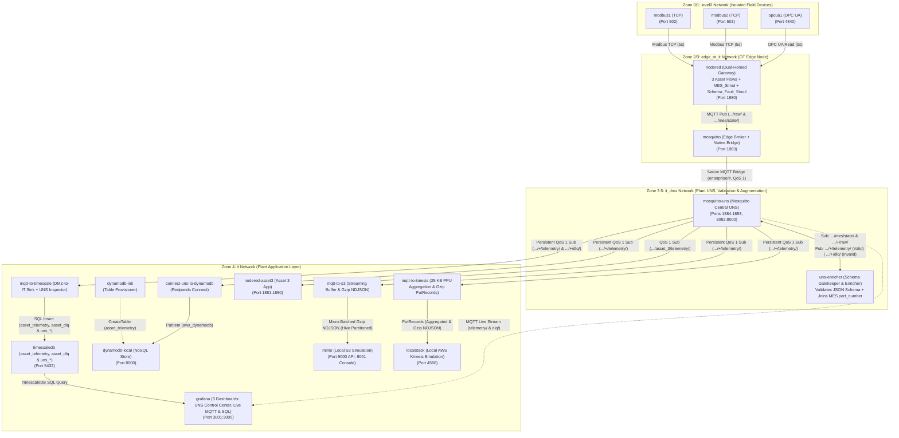

# Industrial IoT Unified Namespace (UNS) & Data Pipeline

A production-grade, containerized Industrial IoT (IIoT) simulation and Unified Namespace (UNS) architecture powered by **Two-Tier Eclipse Mosquitto**, **Node-RED**, **TimescaleDB**, **Redpanda Connect**, **AWS DynamoDB Local**, and **Grafana**.

---

## Architecture Overview

This project implements an ISA-95 / Purdue Model aligned, 4-tier segmented network architecture:



---

## Services & Network Segmentation

| Service | Container Name | Network Zone(s) | Internal Port | Host Port | Role |
| :--- | :--- | :--- | :--- | :--- | :--- |
| **Modbus 1** | `modbus1` | `level0` | `502` | `502` | Modbus TCP Simulator (`asset_1`). Field isolated. |
| **Modbus 2** | `modbus2` | `level0` | `502` | `503` | Modbus TCP Simulator (`asset_2`). Field isolated. |
| **OPC UA 1** | `opcua1` | `level0` | `4840` | `4840` | OPC UA Simulator (`asset_3`). Field isolated. |
| **Node-RED Edge** | `nodered` | `level0`, `edge_ot_it` | `1880` | `1880` | OT Gateway: Polls devices, runs `MES_Simul` & `Schema_Fault_Simul`. |
| **Mosquitto Edge** | `mosquitto` | `edge_ot_it`, `it_dmz` | `1883` | `1883` | Edge Broker: Disk persistence (50k queue) + QoS 1 bridge to UNS. |
| **Mosquitto UNS** | `mosquitto-uns` | `it_dmz` | `1883`, `8000` | `1884`, `8083` | Central UNS MQTT Broker (TCP & WebSockets). |
| **UNS Enricher** | `uns-enricher` | `it_dmz` | - | - | In-UNS JSON Schema Validator and MES part_number context enricher. |
| **MQTT to Timescale** | `mqtt-to-timescale` | `it_dmz`, `it` | - | - | UNS-to-IT SQL Sink & real-time UNS Inspector daemon. |
| **TimescaleDB** | `timescaledb` | `it` | `5432` | `5432` | Time-series database storing `asset_telemetry`, `asset_dlq`, and `uns_*`. |
| **Connect: UNS -> DynamoDB** | `connect-uns-to-dynamodb` | `it_dmz`, `it` | `4195` | - | Redpanda Connect streaming UNS telemetry into DynamoDB. |
| **DynamoDB Local** | `dynamodb-local` | `it` | `8000` | `8000` | Local AWS DynamoDB instance persisting items in `./dynamodb/data`. |
| **DynamoDB Init** | `dynamodb-init` | `it` | - | - | One-shot init container provisioning `asset_telemetry` table. |
| **MQTT to S3 Ingestor** | `mqtt-to-s3` | `it_dmz`, `it` | - | - | Production streaming buffer, Gzip NDJSON compression & Hive-partitioned S3 upload. |
| **MinIO (Local S3)** | `minio` | `it` | `9000`, `9001` | `9000`, `9001` | Local S3 API simulation and Web Console storage backend. |
| **MQTT to Kinesis** | `mqtt-to-kinesis` | `it_dmz`, `it` | - | - | 25 KB PPU aggregated & Gzip-compressed AWS Kinesis streaming ingestion microservice. |
| **LocalStack (AWS Kinesis)** | `localstack` | `it_dmz`, `it` | `4566` | `4566` | Local AWS Kinesis cloud emulation service. |
| **Grafana** | `grafana` | `it`, `it_dmz` | `3000` | `3001` | Pre-configured dashboards: Control Center, MQTT Live Stream, SQL Telemetry. |
| **Node-RED App** | `nodered-asset3` | `it`, `it_dmz` | `1880` | `1881` | IT Consumer Application consuming `asset_3` telemetry from Central UNS. |

---

## Quick Start

### 1. Prerequisites
- Docker Engine 20.10+ and Docker Compose v2.0+
- Host ports available: `502`, `503`, `1880`, `1881`, `1883`, `1884`, `3001`, `4566`, `4840`, `5432`, `8000`, `8083`, `9000`, `9001`

### 2. Launch the Pipeline
```bash
docker compose up -d --build
```

### 3. Verify All Services
```bash
docker compose ps -a
```

### 4. Access Web Interfaces & Endpoints
| Service | Endpoint | Credentials |
| :--- | :--- | :--- |
| **Grafana Observability** | [http://localhost:3001](http://localhost:3001) | `admin` / `admin` |
| **Node-RED OT Gateway** | [http://localhost:1880](http://localhost:1880) | None |
| **Node-RED Asset 3 IT App** | [http://localhost:1881](http://localhost:1881) | None |
| **MinIO S3 Web Console** | [http://localhost:9001](http://localhost:9001) | `minioadmin` / `minioadmin` |
| **MinIO S3 API Endpoint** | [http://localhost:9000](http://localhost:9000) | `minioadmin` / `minioadmin` |
| **LocalStack AWS Kinesis API** | [http://localhost:4566](http://localhost:4566) | `test` / `test` |
| **Mosquitto Central UNS (MQTT)** | `localhost:1884` (TCP) / `ws://localhost:8083` (WebSocket) | Anonymous |
| **TimescaleDB (PostgreSQL)** | `localhost:5432` (`telemetry`) | `postgres` / `postgres` |
| **DynamoDB Local** | [http://localhost:8000](http://localhost:8000) | `local` / `local` |

---

## Detailed Documentation

Comprehensive operational and architectural documentation is available in the [`README/`](./README/) directory:

- [**README_MQTT_TO_KINESIS.md**](./README/README_MQTT_TO_KINESIS.md): Production MQTT-to-AWS Kinesis streaming ingestion pipeline, LocalStack emulation, 25 KB Put Payload Unit (PPU) economics, Gzip compression, multi-record `PutRecords` batching, and verification playbook.
- [**README_MQTT_TO_S3.md**](./README/README_MQTT_TO_S3.md): Production MQTT-to-S3 ingestion pipeline, MinIO simulation, S3 cost optimization strategies (>99.9% PUT API reduction, 128 KB minimum billable size mitigation, VPC Gateway Endpoints), dynamic buffering, and verification commands.
- [**README-nodered.md**](./README/README-nodered.md): Complete guide to the data pipeline, schemas, topic naming conventions, and network architecture.
- [**README_DEMO.txt**](./README/README_DEMO.txt): Chronological, step-by-step presenter script and demonstration commands.
- [**README-Transport.md**](./README/README-Transport.md): Deployment and portability guide for fresh machines and WSL2 environments.
- [**README-raspberry.md**](./README/README-raspberry.md): Edge OT Gateway deployment guide for Raspberry Pi and Industrial IPCs.
- [**README_SCHEMA_VALIDATION.txt**](./README/README_SCHEMA_VALIDATION.txt): In-depth guide on JSON Schema validation and Dead-Letter Queue (DLQ) mechanics.
- [**README_AUGMENTATION.txt**](./README/README_AUGMENTATION.txt): Context augmentation, MES part numbering, and dynamic stream enrichment.
- [**README_STORE_AND_FORWARD.md**](./README/README_STORE_AND_FORWARD.md): Store-and-forward architecture, queuing, network loss tolerance, and zero message loss guarantees.
- [**README_FAILURE_MODES.txt**](./README/README_FAILURE_MODES.txt): Failure mode analysis, error recovery, and resilience testing.
- [**README_SECURING.txt**](./README/README_SECURING.txt): Production hardening, TLS configuration, and least-privilege ACLs.
- [**README_TIMESCALE.txt**](./README/README_TIMESCALE.txt): TimescaleDB hypertables, SQL queries, and Grafana dashboard integration.

---

## License

This project is open-source and available under the [MIT License](LICENSE).

