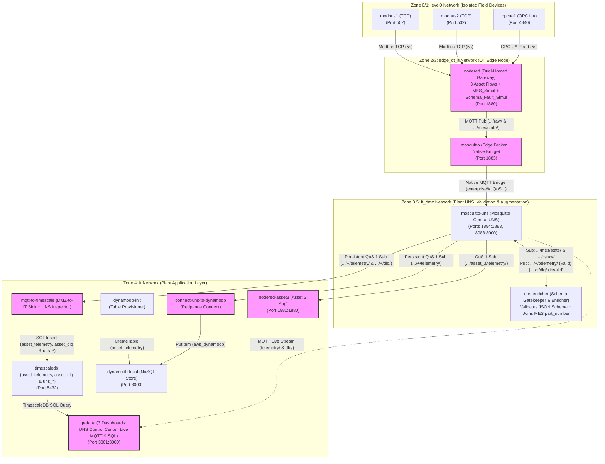

# Complete Industrial IoT Data Pipeline Guide (Mosquitto Central UNS Edition)

This document describes the full End-to-End Industrial IoT simulation, UNS JSON Schema validation, payload augmentation, and data ingestion pipeline powered by **Two-Tier Eclipse Mosquitto (`eclipse-mosquitto:latest`)**:
1. **Modbus TCP Simulators (`modbus1`, `modbus2`)**: Simulate physical sensor devices with fluctuating temperature and humidity registers.
2. **OPC UA Simulator (`opcua1`)**: Simulates industrial equipment exposing Temperature, Humidity, and Motor Speed over OPC UA (`opc.tcp://opcua1:4840`).
3. **Node-RED (`nodered`)**: Polls Modbus and OPC UA devices every 5s, formats standard JSON payloads, and publishes raw telemetry to local edge MQTT topics (`.../asset_{1,2,3}/raw/`). Also runs the **`MES_Simul`** flow tab simulating a Line PLC / MES publishing active production `part_number` and `batch_id` state events (`.../mes/state/`, `retain: true`), and the **`Schema_Fault_Simul`** flow tab for injecting Good and Bad (non-compliant) payloads to test UNS schema governance.
4. **Eclipse Mosquitto Edge (`mosquitto`)**: Dual-homed Edge MQTT broker (`edge_ot_it` + `it_dmz`) with disk-backed persistence (`50,000` msgs) and a **native outbound OASIS MQTT v3.1.1 QoS 1 bridge** (`connection edge-to-uns`) to Mosquitto Central UNS.
5. **Mosquitto Central UNS (`mosquitto-uns`)**: Central Unified Namespace (UNS) MQTT broker in the IT DMZ (`it_dmz`), exposing standard TCP MQTT (`:1884` -> `:1883`) and MQTT over WebSockets (`:8083` -> `:8000`), configured with file persistence and `50,000` queued messages per persistent client session (`mosquitto-uns/config/mosquitto.conf`).
6. **UNS Schema Gatekeeper & Context Enricher (`uns-enricher`)**: In-UNS stream processor (`it_dmz`) that subscribes to the retained `MES_Simul` state topic (`.../mes/state/`) and raw equipment streams (`.../+/raw/`), validates every message against the canonical JSON Schema (`connect/uns-enricher/schemas/telemetry_schema.json`), augments compliant payloads with `part_number`, `batch_id`, and `schema_valid: true` (`.../+/telemetry/`), and routes non-compliant payloads with detailed violation diagnostics to the Dead-Letter Queue (`.../+/dlq/`).
7. **Sink & UNS Inspector: Mosquitto UNS -> TimescaleDB (`mqtt-to-timescale`)**: Dedicated dual-homed container consuming validated telemetry (`.../+/telemetry/`) into `asset_telemetry` and rejected DLQ events (`.../+/dlq/`) into `asset_dlq` in TimescaleDB (`clean_session=False`, QoS 1). Also runs the UNS Inspector tailing `/mosquitto/log/mosquitto.log` and inspecting `enterprise/#` to populate `uns_clients`, `uns_subscriptions`, `uns_topics`, `uns_topic_metrics`, and `uns_client_events`.
8. **TimescaleDB (`timescaledb`)**: PostgreSQL-based time-series database storing validated, enriched sensor telemetry (`asset_telemetry`), quarantined schema violations (`asset_dlq`), and UNS broker observability tables.
9. **Connect: Mosquitto UNS -> DynamoDB (`connect-uns-to-dynamodb`)**: Dedicated **Redpanda Connect** stream processor (`it_dmz` + `it`) subscribing to validated, enriched Mosquitto UNS telemetry (`enterprise/plant/area/sub-area/cell/+/telemetry/`, QoS 1, `clean_session: false`) and streaming items (including `part_number`) into DynamoDB Local.
10. **DynamoDB Local (`dynamodb-local` & `dynamodb-init`)**: Local AWS DynamoDB instance (`:8000`) initialized automatically with the `asset_telemetry` table (`PK: asset_id [S]`, `SK: timestamp [S]`).
11. **Grafana (`grafana`)**: Operational metrics & UNS observability platform (`http://localhost:3001`) hosting three pre-provisioned dashboards:
    - **Mosquitto Central UNS Control Center - Topics, Subscriptions & Clients** (`mosquitto_uns_inspector.json`)
    - **Mosquitto Central UNS Streaming Telemetry - Direct MQTT Stream** (`mosquitto_telemetry.json`)
    - **Plant Telemetry - Modbus & OPC UA Sensors** (`modbus_telemetry.json`)
12. **Node-RED IT Consumer (`nodered-asset3`)**: Downstream IT application subscribing directly to validated, enriched `asset_3` telemetry on the Mosquitto Central UNS broker.

All services run in Docker containers segmented into **4 isolated bridge networks** aligned with the Purdue / ISA-95 model: `level0`, `edge_ot_it`, `it_dmz`, and `it`.

---

## Architecture Flow & Network Zones



---

## Component Details, Ports & Network Zones

| Service | Container Name | Network Zone(s) | Internal Port | Host Port | Role & Boundary Purpose |
| :--- | :--- | :--- | :--- | :--- | :--- |
| **Modbus 1** | `modbus1` | `level0` | `502` | `502` | Modbus TCP Simulator (`asset_1`). Field isolated. |
| **Modbus 2** | `modbus2` | `level0` | `502` | `503` | Modbus TCP Simulator (`asset_2`). Field isolated. |
| **OPC UA 1** | `opcua1` | `level0` | `4840` | `4840` | OPC UA Simulator (`asset_3`). Field isolated. |
| **Node-RED** | `nodered` | `level0`, `edge_ot_it` | `1880` | `1880` | **OT Boundary Gateway**: Polls field devices (`.../raw/`), runs `MES_Simul` (`.../mes/state/`), and runs `Schema_Fault_Simul` (fault injector). |
| **Mosquitto Edge**| `mosquitto` | `edge_ot_it`, `it_dmz` | `1883` | `1883` | **OT-to-UNS Edge Broker & Bridge**: Disk persistence (`50,000` msgs) + native QoS 1 outbound bridge to Mosquitto Central UNS. |
| **Mosquitto UNS** | `mosquitto-uns` | `it_dmz` | `1883`, `8000` | `1884`, `8083` | Central UNS MQTT Broker with file persistence and 50,000-msg persistent client queues. Dual TCP (1883) & WebSockets (8000). |
| **UNS Enricher** | `uns-enricher` | `it_dmz` | - | - | **In-UNS Schema Validator & Enricher**: Validates `.../raw/` against `telemetry_schema.json`, augments valid records (`.../telemetry/`), and quarantines invalid records (`.../dlq/`). |
| **MQTT to Timescale** | `mqtt-to-timescale` | `it_dmz`, `it` | - | - | **UNS-to-IT SQL Sink & Inspector**: Consumes `.../telemetry/` (`asset_telemetry`), `.../dlq/` (`asset_dlq`), and tracks Mosquitto UNS clients, subscriptions, and topics (`uns_*`). |
| **TimescaleDB** | `timescaledb` | `it` | `5432` | `5432` | Long-term PostgreSQL hypertables (`asset_telemetry`, `asset_dlq`, `uns_topic_metrics`, `uns_client_events`) & state tables (`uns_clients`, `uns_subscriptions`, `uns_topics`). |
| **Connect: UNS -> DynamoDB** | `connect-uns-to-dynamodb` | `it_dmz`, `it` | `4195` | - | **UNS-to-IT NoSQL Stream Processor**: Redpanda Connect instance streaming validated, enriched Mosquitto UNS telemetry into DynamoDB Local. |
| **DynamoDB Local** | `dynamodb-local` | `it` | `8000` | `8000` | Local AWS DynamoDB instance persisting items in `./dynamodb/data`. |
| **DynamoDB Init** | `dynamodb-init` | `it` | - | - | One-shot startup container (`dynamodb/init_table.py`) that creates the `asset_telemetry` table. |
| **Grafana** | `grafana` | `it`, `it_dmz` | `3000` | `3001` | Visualization dashboards (`admin` / `admin`): Mosquitto Central UNS Control Center, Mosquitto Central UNS Live MQTT Stream, and Plant SQL Telemetry. |
| **Node-RED App (Asset 3)** | `nodered-asset3` | `it`, `it_dmz` | `1880` | `1881` | **IT Consumer Application**: Subscribes directly to Mosquitto Central UNS topic `enterprise/plant/area/sub-area/cell/asset_3/telemetry/`. |

---

## Native Mosquitto-to-UNS Bridge, UNS Enricher & Downstream Sinks

### 1. Edge Bridge Configuration (`mosquitto/config/mosquitto.conf`)
```conf
listener 1883
allow_anonymous true
persistence true
persistence_location /mosquitto/data/
autosave_interval 60
max_queued_messages 50000
persistent_client_expiration 7d

# Native OT-to-DMZ Bridge (Mosquitto -> Mosquitto UNS)
connection edge-to-uns
address mosquitto-uns:1883
remote_clientid edge-to-uns
topic enterprise/# out 1
cleansession false
try_private false
notifications false
bridge_protocol_version mqttv311
bridge_attempt_unsubscribe false
restart_timeout 2 10
```
- **Strict OASIS MQTT v3.1.1 Compliance**: `try_private false` and `notifications false` ensure Mosquitto connects with the standard OASIS MQTT 3.1.1 protocol byte (`0x04`) and does not publish `$SYS/...` bridge notifications, which Mosquitto UNS strictly prohibits.
- **Zero-Loss Outbound Buffering**: When `mosquitto-uns:1883` is unreachable, Mosquitto holds all outbound `enterprise/#` QoS 1 messages in its persistent disk queue (`/mosquitto/data/mosquitto.db`, up to `50,000` messages / ~23.1 hours) until `mosquitto-uns` returns `PUBACK`, draining the backlog automatically upon reconnection.

### 2. In-UNS Schema Validation & Payload Augmentation (`connect/uns-enricher/enricher.py`)
- Subscribes to `enterprise/plant/area/sub-area/cell/mes/state/` (retained on `mosquitto-uns`) to track the active `part_number` and `batch_id` emitted by the **`MES_Simul`** flow in Node-RED.
- Subscribes to `enterprise/plant/area/sub-area/cell/+/raw/` (`QoS 1`, `clean_session=False`) and validates every payload against `connect/uns-enricher/schemas/telemetry_schema.json` (Draft 2020-12 JSON Schema).
- **Valid payloads**: Augmented with `part_number`, `batch_id`, and `schema_valid: true`, and published to `enterprise/plant/area/sub-area/cell/<asset_id>/telemetry/`.
- **Invalid payloads**: Blocked from `.../telemetry/` and routed to the Dead-Letter Queue topic `enterprise/plant/area/sub-area/cell/<asset_id>/dlq/` with exact violation details (`error_type`, `failed_field`, `schema_rule`, `reason`). See `README_SCHEMA_VALIDATION.txt` for full details.

### 3. DMZ-to-IT TimescaleDB Sink & Mosquitto UNS UNS Inspector (`connect/mqtt-to-timescale/sink.py`)
- Connects to `mosquitto-uns:1883` with `client_id="timescaledb-group"`, `clean_session=False`, and `qos=1` on topics `enterprise/plant/area/sub-area/cell/+/telemetry/` and `enterprise/plant/area/sub-area/cell/+/dlq/`.
- Inserts validated telemetry into `asset_telemetry (time, payload)` and rejected schema violations into `asset_dlq (time, asset_id, error_type, failed_field, reason, payload)`.
- Only sends MQTT `PUBACK` to `mosquitto-uns` after the SQL `INSERT` commits.
- Also runs `MosquittoUnsInspector` in the background, tailing `/mosquitto/log/mosquitto.log` and monitoring `enterprise/#` to maintain real-time broker observability tables (`uns_clients`, `uns_subscriptions`, `uns_topics`, `uns_topic_metrics`, and `uns_client_events`) for the **Mosquitto UNS UNS Control Center** Grafana dashboard.

### 4. DMZ-to-IT Redpanda Connect -> DynamoDB Pipeline (`connect/mosquitto-to-dynamodb.yaml`)
Subscribes to `mosquitto-uns:1883` (`enterprise/plant/area/sub-area/cell/+/telemetry/`, QoS 1, persistent session `redpanda-connect-dynamodb`) and writes structured items (including `part_number`) into `dynamodb-local:8000` (`asset_telemetry` table with Partition Key `asset_id` and Sort Key `timestamp`):
```yaml
input:
  mqtt:
    urls:
      - "tcp://mosquitto-uns:1883"
    topics:
      - "enterprise/plant/area/sub-area/cell/+/telemetry/"
    client_id: "redpanda-connect-dynamodb"
    clean_session: false
    qos: 1
    auto_replay_nacks: true

pipeline:
  processors:
    - mapping: |
        root = this
        root.topic = if this.topic != null { this.topic } else { @mqtt_topic }
        root.asset_id = this.asset_id.or("unknown")
        root.part_number = this.part_number.or("UNKNOWN")
        root.timestamp = this.timestamp.or(now())
    - log:
        level: INFO
        message: "Streaming from Mosquitto UNS to DynamoDB: asset=${!json(\"asset_id\")} part=${!json(\"part_number\")} device=${!json(\"device\")} temp=${!json(\"temperature\")}°C hum=${!json(\"humidity\")}% ts=${!json(\"timestamp\")}"

output:
  aws_dynamodb:
    table: "asset_telemetry"
    endpoint: "http://dynamodb-local:8000"
    region: "us-east-1"
    credentials:
      id: "local"
      secret: "local"
    string_columns:
      asset_id: "${!json(\"asset_id\")}"
      timestamp: "${!json(\"timestamp\")}"
      part_number: "${!json(\"part_number\")}"
      device: "${!json(\"device\")}"
      topic: "${!json(\"topic\")}"
    json_map_columns:
      payload: "."
```

---

## Verification & Monitoring Commands

### 1. Check All Containers
```bash
docker compose ps -a
```

### 2. Inspect Mosquitto UNS Clients, Subscriptions & Topics via CLI
```bash
docker compose exec -T timescaledb psql -U postgres -d telemetry \
  -c "SELECT client_id, status, role, ip_address, clean_start, messages_in, messages_out FROM uns_clients ORDER BY clean_start, client_id;" \
  -c "SELECT subscription_id, client_id, client_status, topic_filter, matched_topics_count, routed_messages FROM uns_subscriptions ORDER BY subscription_id;" \
  -c "SELECT topic, stage, publisher_client_id, retained, subscriber_count, message_count, total_bytes FROM uns_topics ORDER BY stage, topic;"
```

### 3. Watch In-UNS Payload Augmentation Logs
```bash
docker compose logs -f uns-enricher
```

### 4. Tail Redpanda Connect -> DynamoDB Stream Logs
```bash
docker compose logs -f connect-uns-to-dynamodb
```

### 5. Query Items Stored in DynamoDB Local
Run the included zero-dependency query script (`dynamodb/query_table.py`):
```bash
python3 dynamodb/query_table.py
```
Or run it inside a container attached to the `it` network:
```bash
docker run --rm --net=it \
  -v $(pwd)/dynamodb/query_table.py:/app/query_table.py:ro \
  -e DYNAMODB_ENDPOINT=http://dynamodb-local:8000 \
  python:3.11-slim python /app/query_table.py
```

### 6. Query Latest Augmented Records in TimescaleDB
```bash
docker compose exec timescaledb psql -U postgres -d telemetry -P pager=off -c "
SELECT time,
       payload->>'asset_id' AS asset,
       payload->>'part_number' AS part_number,
       payload->>'batch_id' AS batch_id,
       payload->>'temperature' AS temp_c,
       payload->>'humidity' AS hum_pct,
       payload->>'motor_speed' AS motor_rpm
FROM asset_telemetry
ORDER BY time DESC
LIMIT 6;
"
```
