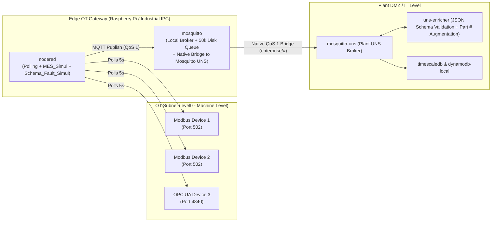

# Edge OT Gateway Deployment Guide: Raspberry Pi & Industrial IPCs

This document details the feasibility, resource requirements, hardware recommendations, and best practices for running the Edge OT Gateway stack (**Node-RED** and **Eclipse Mosquitto** with native outbound MQTT bridging) containerized in Docker on Raspberry Pi and Industrial PC (IPC) platforms in a manufacturing environment.

---

## 1. Edge Gateway Role & Architecture

In this architecture, the central Unified Namespace (**Mosquitto UNS** and **`uns-enricher`**) and Plant IT services (**TimescaleDB**, **DynamoDB Local**, **Grafana**, and **Node-RED Asset 3 App**) run upstream in a plant DMZ / data center or cloud environment.

The edge machine functions strictly as an **OT (Operational Technology) Gateway** on the manufacturing line:



---

## 2. Resource Feasibility & Live Docker Benchmarks

Running the Edge OT Gateway services (`nodered` and `mosquitto`) containerized in Docker on an ARM64-based platform like Raspberry Pi is **completely feasible** and extremely lightweight. Because Mosquitto handles the northbound bridge to Mosquitto UNS natively in C, no separate sidecar bridge container is needed on the edge host.

### Why Docker Overhead is Negligible on Linux
Unlike Virtual Machines (VMs), Linux containers are **native host processes** isolated through Linux kernel namespaces and cgroups:
- **0% CPU penalty**: Instructions execute natively on the ARM CPU without emulation or translation.
- **Minimal daemon footprint**: Docker Engine (`dockerd`) and `containerd` consume only **~35–50 MB** of host RAM.

### Measured Resource Breakdown (Live Ingestion Every 5s)

| Service | Technology | Runtime Memory (RAM) | CPU Utilization | Container Disk Size |
| :--- | :--- | :--- | :--- | :--- |
| **`mosquitto`** | C / Alpine (Broker + Native Bridge) | **2.6 MB** | `< 0.1%` | ~4.1 kB (25 MB image) |
| **`nodered`** | Node.js runtime (`modbus`, `opcua`, `MES_Simul`, `Schema_Fault_Simul`) | **72.2 MB** | `~0.4%` | ~4.1 kB (450 MB image) |
| **Docker Engine & containerd** | Go background daemons | **~35 – 50 MB** | `< 0.2%` | — |
| **Total Edge Stack** | — | **~110 – 125 MB** | **< 1.0%** | **~475 MB total disk** |

> [!NOTE]
> On a **Raspberry Pi 4 / 5 (2 GB or 4 GB RAM)**, the total system memory utilization (Linux OS + Docker Engine + Edge containers) is **less than 300 MB**, leaving **1.7 GB to 3.7 GB of free headroom**.

---

## 3. Production Considerations for Manufacturing Environments

While consumer Raspberry Pi boards (RPi 4 / RPi 5) work well for testing, deploying bare consumer hardware directly onto a factory floor presents physical and operational risks.

### A. Storage Reliability (The #1 Industrial Risk)
- **Problem**: Consumer MicroSD cards will eventually corrupt or wear out from continuous write cycles and sudden plant power cuts.
- **Requirement**: Use **onboard industrial eMMC storage** or **M.2 NVMe SSDs** for `/mosquitto/data/mosquitto.db` and `/data`.

### B. Network Segmentation & Cybersecurity (ISA/IEC 62443)
- **Problem**: Machine-level OT networks (PLCs, sensors, drives) should never be directly bridged to enterprise IT or wide-area networks.
- **Requirement**: An industrial edge gateway must feature **dual independent physical Ethernet ports (Dual NICs)**:
  - **NIC 1 (OT LAN - `level0`)**: Connects exclusively to the machine network (Modbus / OPC UA devices).
  - **NIC 2 (DMZ/Plant LAN - `it_dmz`)**: Connects to the plant DMZ for bridging MQTT telemetry upstream to Mosquitto UNS (`mosquitto-uns:1883`).

### C. Power Supply & Industrial Form Factor
- Factory control cabinets supply **24V DC DIN-rail** power.
- Consumer 5V USB-C supplies lack industrial reverse polarity, overvoltage, and electrical noise (EMC/ESD) isolation.

---

## 4. Recommended Production Hardware Platforms

For manufacturing deployments, use **Industrial Raspberry Pi (Compute Module 4 / CM5)** or dedicated ARM-based Industrial PCs:

| Platform | Processor / Base | Key Industrial Features |
| :--- | :--- | :--- |
| **Kunbus Revolution Pi (RevPi Connect)** | RPi CM4 | 24V DC DIN-rail, 2x Gigabit Ethernet, onboard eMMC, hardware watchdog, -40°C to +55°C operating range |
| **OnLogic Factor 201** | RPi CM4 | Rugged fanless aluminum chassis, dual Ethernet, isolated RS-485 / Modbus serial ports, M.2 NVMe storage |
| **Siemens SIMATIC IOT2050** | ARM (TI AM6528) | Industrial grade, dual Ethernet, CE/UL certifications, native Node-RED and Docker support |
| **Advantech UNO-220 / UNO-1251** | RPi CM4 / ARM | Ruggedized DIN-rail IPC with isolated COM ports, dual LAN, and wide temperature tolerances |

---

## 5. Docker Best Practices for Edge Gateways

### 1. Docker Log Rotation (Mandatory for Flash Storage)
To prevent container stdout/stderr logs from filling up edge storage, enforce log rotation in `/etc/docker/daemon.json` on the gateway:

```json
{
  "log-driver": "json-file",
  "log-opts": {
    "max-size": "10m",
    "max-file": "3"
  }
}
```
*Effect: Caps each container's log history to a maximum of 30 MB.*

### 2. Restart Policy
Always set `restart: unless-stopped` or `restart: always` in your edge `docker-compose.yml` so that all gateway services automatically resume after a machine power cycle.

### 3. Local Volume Mounts
Ensure host volume mounts for Node-RED flows (`/data`) and Mosquitto persistence (`/mosquitto/data`) are mapped to persistent storage paths (`eMMC` or SSD), not temporary volatile mounts.

---

## Summary Verdict

| Environment | Recommended Hardware | Verdict |
| :--- | :--- | :--- |
| **Prototyping / Lab Testing** | Standard Raspberry Pi 4 / 5 (2GB+) with High-Endurance SD or USB-SSD | **Fully Supported & Cost Effective** |
| **Production Manufacturing Line** | Industrial CM4-based IPC (e.g., Kunbus RevPi, OnLogic Factor 201) | **Industry Standard & Production Ready** |
